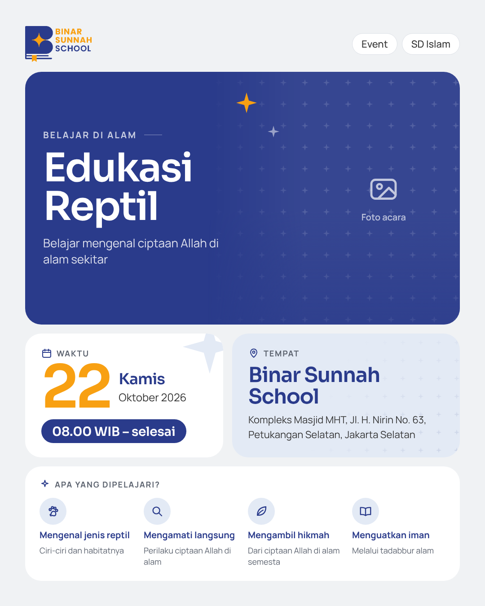

# Poster Event

Template Instagram feed **1080×1350 (4:5)** untuk acara sekolah yang memakai **foto ilustrasi**, misalnya edukasi alam, field trip, lomba, atau bazar. Template ini bagian dari [Design System Binar](../../Design%20System%20Binar.md#10-template-instagram).

**Prioritas informasi:**
1. **Waktu dan tempat** (dua kartu terbesar)
2. Foto dan judul
3. Materi



## Isi folder
| File | Fungsi |
|---|---|
| `Poster Event.html` | Template. Semua isi diatur dari objek `DATA` di bagian atas file. |
| `logo.png` | Logo Binar Sunnah School. |
| `export.js` | Ekspor ke PNG 1080×1350. |
| `preview.png` | Contoh tampilan tanpa foto (placeholder). |

## Cara pakai
1. Siapkan **foto ilustrasi acara** (JPG/PNG, minimal lebar 1000px), simpan sebagai `foto-acara.jpg` di folder ini, lalu isi `foto: "foto-acara.jpg"`. Selama `foto` kosong, area foto menampilkan placeholder "Foto acara". Foto akan memudar ke navy dari kiri, jadi subjek foto sebaiknya berada di sisi kanan.
2. Ubah objek `DATA`:
   - **Judul:** `eyebrow`, `judul`, `sub`
   - **Foto:** `foto`, `fotoPosisi` (misalnya `"center"`, `"right top"`, `"60% 40%"`)
   - **Waktu dan tempat:** `hari`, `tanggal`, `bulanTahun`, `jam`, `tempat`, `alamat`
   - **Materi:** `materi`, 2–4 butir dengan `ikon` pilihan `"hewan"`, `"cari"`, `"daun"`, `"kitab"`, `"bintang"`, `"orang"`, `"piala"`, `"mik"`, atau `"hadiah"`
3. Ekspor:
   ```bash
   node export.js poster-edukasi-reptil.png
   ```

> Foto acara dan hasil ekspor (`foto*`, `poster*.png`) di-ignore Git. Kalau foto menampilkan santri, pastikan sudah ada izin orang tua.

## Anatomi
| Area | Isi | Token |
|---|---|---|
| Header | Logo di kiri, tag netral (misalnya "Event", "SD Islam") di kanan | `--margin: 56px` |
| Hero (navy) | Eyebrow dengan garis penyerta, judul **Sora 600 88px**, subjudul. **Foto ilustrasi** di 72% sisi kanan. Foto memudar ke navy secara **halus** dengan kurva ease (10 titik bertahap, bukan garis lurus), plus overlay navy tipis di bawah. Bintang amber dan putih kecil. | `--binar-navy`, `--radius-card: 36px` |
| **Kartu waktu** (putih) | Ikon kalender, **angka tanggal 132px solid amber** (satu fokus), hari Sora 600 navy, bulan dan tahun, **pill jam navy** besar | `--surface`, `--binar-amber`, `--binar-navy` |
| **Kartu tempat** (biru muda, lebih lebar) | Ikon pin, **nama tempat Sora 600 46px** navy, alamat. Pola bintang navy samar di pojok. | `--binar-blue-50` |
| Kartu materi (putih) | Label "Apa yang dipelajari?", 2–4 kolom berisi ikon garis dalam lingkaran biru muda, judul navy, dan keterangan | `--surface`, `--binar-blue-50` |

## Aturan
- **Waktu dan tempat harus selalu jadi kartu terbesar setelah hero.** Jangan pindahkan ke bawah atau perkecil.
- **Amber hanya untuk angka tanggal** dan bintang ornamen.
- **Foto tidak boleh menimpa teks.** Subjudul dibatasi 400px. Kalau subjek foto terlalu ke kiri, atur `fotoPosisi`.
- **Overlay foto selalu navy, bukan hitam.** Jangan memakai foto yang masih berisi teks atau ornamen dari desain lain.
- **Judul maksimal 2 baris** (sekitar 2 kata pendek). Subjudul maksimal 2 baris.
- **Materi maksimal 4 butir**: judul 2–3 kata, keterangan maksimal 2 baris.
- Teks di pill harus *middle* (`text-box: trim-both cap alphabetic`).
