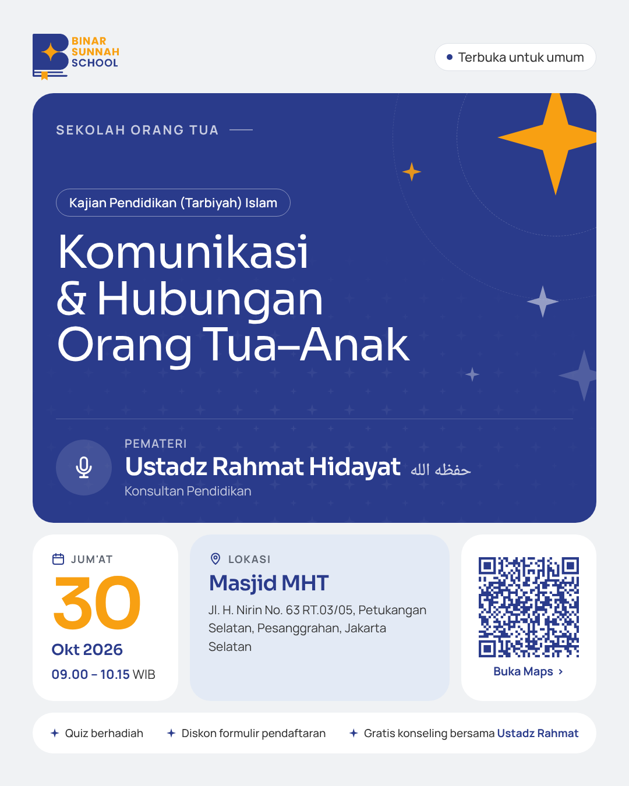

# Poster Kajian

Template Instagram feed **1080×1350 (4:5)** untuk pengumuman kajian, misalnya seri **Sekolah Orang Tua**. Template ini bagian dari [Design System Binar](../../Design%20System%20Binar.md#10-template-instagram).



## Isi folder
| File | Fungsi |
|---|---|
| `Poster Kajian.html` | Template. Semua teks diisi dari objek `DATA` di bagian atas file. |
| `logo.png` | Logo Binar Sunnah School. |
| `qr.png` | Contoh QR (Google Maps "Masjid MHT Petukangan Selatan"). Ganti dengan QR lokasi kajian. |
| `export.js` | Ekspor ke PNG 1080×1350. |
| `preview.png` | Contoh tampilan. |

## Cara pakai
1. Buka `Poster Kajian.html`, lalu ubah objek `DATA`:
   - `seri`, `kategori`, `judul`
   - `pemateri`, `gelarArab`, `peran`
   - `tanggal`, `bulanTahun`, `hari`, `jam`
   - `tempat`, `alamat`, `qr`
   - `tagHeader`, `keuntungan`
2. **QR:** buat QR untuk link Google Maps lokasi, simpan sebagai `qr.png` di folder ini.
3. **Foto pemateri (opsional):** simpan sebagai `foto-pemateri.png`, lalu isi `fotoPemateri: "foto-pemateri.png"`. Kalau dikosongkan, yang tampil ikon mikrofon.
4. Ekspor ke PNG:
   ```bash
   node export.js poster-kajian-oktober.png
   ```

## Anatomi
| Area | Isi | Token |
|---|---|---|
| Header | Logo sejajar tepi kiri kartu, tag netral "Terbuka untuk umum" sejajar tepi kanan | `--margin: 56px` |
| Hero (navy, selebar poster, rata kiri) | Seri diikuti garis tipis di atas. Pill kategori outline putih dan judul Sora 400 78px berada di **tengah vertikal**, dengan jarak ke seri dan ke pemateri sama. Lalu garis pemisah, pemateri (avatar/ikon, nama Sora 600 + gelar Arab, peran). Ornamen: bintang amber besar dengan 2 orbit putus-putus, bintang kecil, dan pola bintang samar. | `--binar-navy`, `--radius-card: 36px` |
| Kartu tanggal (putih) | Ikon kalender + hari, **angka tanggal besar solid amber**, bulan dan tahun, jam | `--surface`, `--binar-amber` |
| Kartu lokasi (biru muda) | Ikon pin + label, nama tempat Sora 600 navy, alamat | `--binar-blue-50` |
| Kartu QR (putih) | QR navy dan label "Buka Maps ›" | `--surface` |
| Strip keuntungan (pill putih) | Maksimal 3 butir pendek, bullet bintang navy | `--surface`, `--binar-navy` |

## Aturan
- **Amber hanya untuk angka tanggal** (satu fokus) dan bintang ornamen. Elemen lain memakai navy, biru muda, atau putih.
- **Judul maksimal 3 baris.** Kalau lebih panjang, persingkat judulnya. Ukuran font jangan dikecilkan.
- **Gelar Arab** (حفظه الله) memakai font Noto Naskh Arabic, diletakkan setelah nama pemateri.
- **Keuntungan maksimal 3 butir**, cukup satu baris. Bagian yang ditulis `**...**` akan ditebalkan dengan warna navy.
- Tidak ada blob, gradien, atau kuning lemon. Ornamen hanya turunan bintang empat sudut: bintang, pola bintang samar, orbit, garis penyerta, dan ikon garis (lihat [7.0 Ornamen](../../Design%20System%20Binar.md#70-ornamen)).
- Ornamen tidak boleh menimpa judul atau teks lain. Kalau judul berubah panjang, cek ulang posisi bintang kecil.
- **Jangan pakai hitam atau charcoal bersama amber.**
