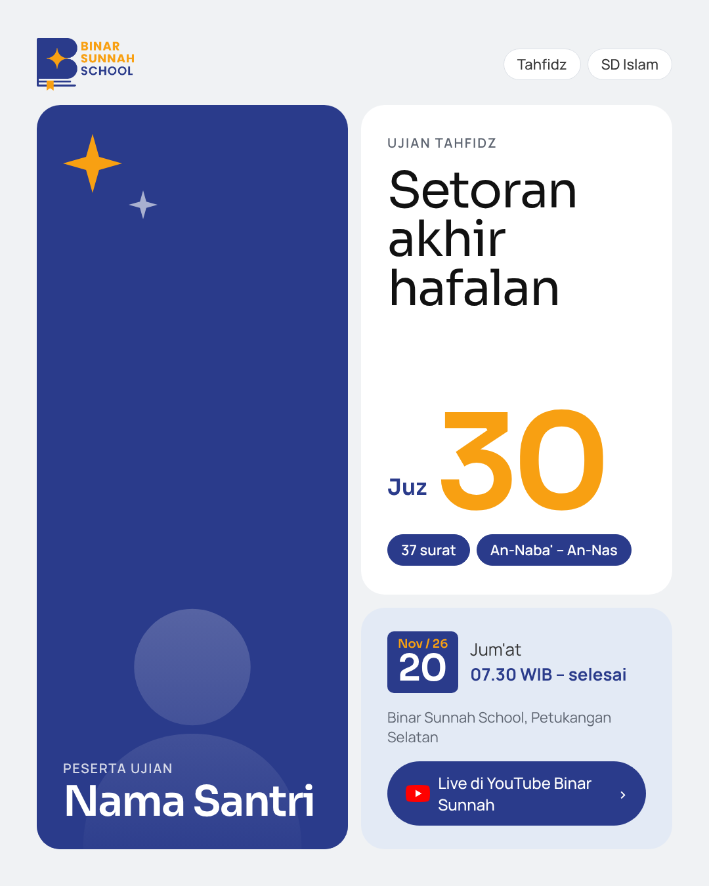

# Poster Ujian Tahfidz

Template Instagram feed **1080×1350 (4:5)** untuk pengumuman ujian tahfidz santri Binar Sunnah School. Template ini bagian dari [Design System Binar](../../Design%20System%20Binar.md#10-template-instagram).



## Isi folder
| File | Fungsi |
|---|---|
| `Poster Ujian Tahfidz.html` | Template. Semua teks diisi dari objek `DATA` di bagian atas file. |
| `logo.png` | Logo Binar Sunnah School (navy + amber). |
| `youtube-icon.png` | Ikon YouTube resmi (merah `#FF0000` + segitiga putih, latar transparan). |
| `export.js` | Ekspor ke PNG 1080×1350. |
| `preview.png` | Contoh tampilan tanpa foto. |

## Cara pakai
1. Siapkan foto santri sebagai **PNG transparan** (latar sudah dihapus, setengah badan, menghadap depan). Simpan di folder ini dengan nama `foto.png`.
2. Buka `Poster Ujian Tahfidz.html` di editor, lalu ubah objek `DATA`:
   ```js
   nama: "Ukkasyah", juz: "30", tanggal: "20", bulanTahun: "Nov / 26",
   hari: "Jum'at", jam: "07.30 WIB – selesai", wajahX: "62%"
   ```
   `wajahX` adalah posisi tengah wajah di dalam foto, dihitung dalam persen dari kiri. Atur nilainya sampai wajah berada di tengah kartu.
3. Ekspor ke PNG:
   ```bash
   node export.js poster-ukkasyah.png
   ```
   Cara lain: buka file HTML di Chrome, lalu screenshot elemen `#poster`.

> Foto santri dan hasil ekspor (`foto*.png`, `poster*.png`) sengaja di-ignore Git supaya foto anak tidak ikut ter-upload ke repo.

## Anatomi
| Area | Isi | Token |
|---|---|---|
| Header | Logo sejajar tepi kiri kartu, tag sejajar tepi kanan kartu | `--margin: 56px` |
| Kartu foto | Latar navy, 2 bintang, foto di tengah, gradien navy di bawah, nama | `--binar-navy`, `--radius-card: 36px` |
| Kartu info | Eyebrow, judul Sora 400, "Juz" + angka besar **solid amber**, tag highlight (jumlah halaman/surat dan nama surat) navy dengan teks putih | `--surface`, `--binar-amber`, `--binar-navy` |
| Kartu jadwal | Badge tanggal navy, hari dan jam, tempat, tombol pill navy | `--binar-blue-50` |

## Aturan
- Angka juz selalu **solid amber**, jangan dibuat outline.
- Tag di kartu info (jumlah halaman/surat, rentang surat) adalah **tag highlight**: latar **navy**, teks **putih** Manrope 600, isinya label pendek. Amber hanya untuk angka juz. Tag di header tetap netral (putih, border abu).
- Kartu jadwal memakai **biru muda `--binar-blue-50`**. **Jangan pakai hitam atau charcoal bersama amber.**
- Logo dan tag sejajar dengan **tepi kartu**, bukan dengan isi kartu.
- Tidak ada lingkaran atau bentuk dekoratif di belakang foto. Cukup latar navy dan bintang.
- Tombol live streaming memakai **ikon YouTube resmi** (`youtube-icon.png`) setinggi 26px. Jangan menggambar ulang atau mewarnai ulang ikonnya.
