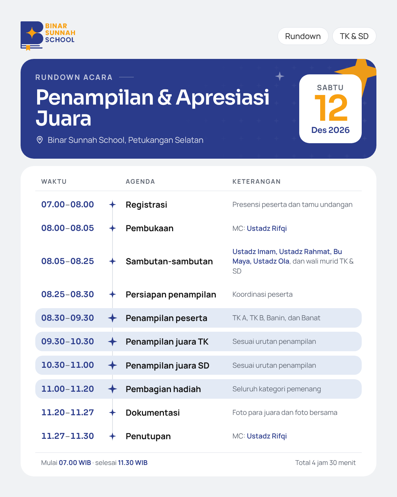

# Rundown Acara

Template Instagram feed **1080×1350 (4:5)** untuk susunan acara. Template ini **pasangan dari [Poster Event](../Poster%20Event/)**: poster mengumumkan acaranya, rundown menjelaskan urutan acaranya. Bagian dari [Design System Binar](../../Design%20System%20Binar.md#10-template-instagram).



## Isi folder
| File | Fungsi |
|---|---|
| `Rundown Acara.html` | Template. Semua isi diatur dari objek `DATA` di bagian atas file. |
| `logo.png` | Logo Binar Sunnah School. |
| `export.js` | Ekspor ke PNG 1080×1350. |
| `preview.png` | Contoh tampilan. |

## Cara pakai
1. Ubah objek `DATA`:
   - **Acara:** `eyebrow`, `judul`, `tempat`, `hari`, `tanggal`, `bulanTahun`, `tagHeader`
   - **Rundown:** daftar baris `{ mulai, selesai, agenda, ket, sorot }`
     - `mulai` dan `selesai` ditulis `"07.00"`
     - `sorot: true` untuk inti acara (diberi latar biru muda)
     - bagian dalam `**...**` di `ket` ditebalkan navy, untuk nama MC atau pemberi sambutan
2. Ekspor:
   ```bash
   node export.js rundown-acara.png
   ```
3. Baris "Mulai · selesai" dan "Total durasi" di bawah dihitung otomatis dari baris pertama dan terakhir.

## Anatomi
| Area | Isi | Token |
|---|---|---|
| Header | Logo di kiri, tag netral (misalnya "Rundown", "TK & SD") di kanan | `--margin: 56px` |
| Hero (navy, ringkas) | Eyebrow dengan garis penyerta, nama acara Sora 600 56px, ikon pin dan tempat. Di kanan ada **kartu tanggal putih** berisi hari, **angka tanggal amber 96px** (satu fokus), bulan dan tahun. Ornamen: bintang amber terpotong dan pola bintang samar. | `--binar-navy`, `--binar-amber` |
| Timeline (putih) | Kolom **waktu** (Sora 600 navy, `07.00–08.00`), **titik bintang navy** di garis vertikal, **agenda** (Manrope 700), dan **keterangan** (abu, nama tebal navy). Baris inti acara memakai latar `--binar-blue-50` dan bintang lebih besar. | `--surface`, `--binar-blue-50` |
| Ringkasan | Mulai, selesai, dan total durasi | `--muted` |

## Aturan
- **Maksimal 10 baris.** Gabungkan agenda yang sejenis. Contohnya, beberapa sambutan ditulis sebagai satu baris **"Sambutan-sambutan"**, dengan nama pemberi sambutan di keterangan.
- **Sorot hanya inti acara** (penampilan, lomba, pembagian hadiah), sekitar 2–4 baris. Pembukaan, transisi, dokumentasi, dan penutupan tidak disorot.
- **Amber hanya untuk angka tanggal.** Titik timeline memakai bintang navy.
- **Agenda maksimal 3 kata. Keterangan maksimal 2 baris.**
- Format jam selalu `HH.MM` dengan titik, sesuai penulisan Indonesia.
